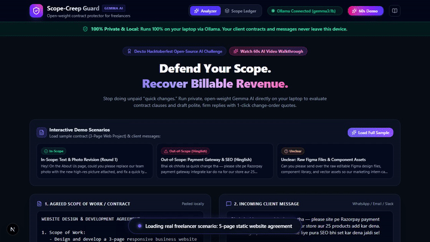

# 🛡️ Scope-Creep Guard

> **A local-first, privacy-focused open-weight AI tool for freelancers and contractors to defend project scope, prevent unpaid work, and recover lost billable revenue.**

[](https://week-iota.vercel.app)
[](https://github.com/vidishagupta/scope-creep-guard)
[](https://dev.to)
[-4285F4?style=for-the-badge)](https://ollama.com)
[](LICENSE)

---

## 🔗 Quick Links
- **Live Production URL:** [https://week-iota.vercel.app](https://week-iota.vercel.app)
- **GitHub Repository:** [https://github.com/vidishagupta/scope-creep-guard](https://github.com/vidishagupta/scope-creep-guard)
- **Demo Video (MP4):** [demo/scope-creep-guard-demo.mp4](demo/scope-creep-guard-demo.mp4)

---

## 🎬 Demo Preview



> 📹 **[Watch the Full 60-Second Walkthrough Video (MP4)](demo/scope-creep-guard-demo.mp4)** — AI detects Hinglish scope creep, quotes ₹12,000 extra work, copies firm pushback, and updates recovered revenue in the Scope Ledger.

---

## 🚨 The Problem: "Can you just do this one quick change?"
Every freelancer knows this trap:
You agree to deliver a 3-page website. You finish on time. Then the client WhatsApp messages start:
> *"Bhai ek chhota sa change tha — store ke liye Razorpay payment gateway integrate kar do na jaldi se, aur SEO bhi set kar dena Google ke liye!"*

Freelancers often say yes because:
1. Saying "no" feels confrontational and awkward.
2. They don't have contract clauses memorized word-for-word.
3. They lack a tactful way to quote extra work without annoying the client.

**The result:** Freelancers lose 20% to 35% of their billable hours doing unpaid work. At ₹1,000/hr ($50/hr), that translates to ₹30,000–₹60,000+ ($1,500–$3,000+) in leaked revenue every project.

---

## 💼 Who Would Pay For This?
1. **Independent Freelancers & Web Developers:** Who lose money to scope creep and struggle with awkward client boundary conversations.
2. **Design & Dev Boutique Agencies:** Managing multiple simultaneous client accounts where project managers need objective proof of out-of-scope requests before escalating.
3. **Upwork & Fiverr Contractors:** Needing clear contractual paper trails to protect job ratings and justify change-order billing.

---

## ✨ Core Features
- **Strict Contract Analysis:** Evaluates incoming client requests against the agreed Scope of Work using local open-weight Google Gemma.
- **Strict Adherence System Prompt:** Judges **only** by the pasted contract. Never hallucinates assumptions. If the contract is silent on an item, returns `UNCLEAR`.
- **Financial Leakage Calculator:** Computes realistic extra billable hours and extra charges dynamically based on the freelancer's hourly rate and currency (₹ INR, $ USD, € EUR, etc.).
- **3 Ready-to-Send Reply Options:**
  - **Polite:** Diplomatic, constructive, maintains positive rapport.
  - **Firm:** Direct, strictly references contract terms without apologizing.
  - **Friendly Upsell:** Enthusiastic, frames the request as a high-value Phase 2 add-on.
- **1-Click Change-Order Mini Quote:** Auto-generates a clean estimate note ready to copy-paste into WhatsApp, Slack, or email.
- **Local Scope Ledger Dashboard:** Saves all analyzed requests in browser `localStorage`. Displays:
  - Total requests checked
  - Out-of-scope requests caught
  - Total extra revenue identified
  - **"Money Recovered"** (updates whenever a client agrees to pay).
  - One-click CSV and JSON exports.
- **Interactive Sample Scenarios:** 1-click loading of realistic website agreements and sample messages (In-Scope, Out-of-Scope Hinglish, and Unclear).

---

## 🔒 Why Open-Source AI Matters Here
Scope-Creep Guard deliberately rejects closed cloud AI APIs (no OpenAI, no Gemini API, no Anthropic API) in favor of local open-weight models for 5 critical reasons:

| Pillar | Why Open-Source Local AI Wins |
| :--- | :--- |
| **1. NDA & Client Privacy** | Freelancer contracts often contain strict Non-Disclosure Agreements (NDAs), trade secrets, and confidential pricing. Local Gemma runs 100% on the laptop—contract data **never leaves the device**. |
| **2. Zero Operating Cost** | No monthly API subscriptions, credit card requirements, or surprise per-token charges. Free forever for any freelancer. |
| **3. Works 100% Offline** | Review client messages and generate change-orders on airplanes, trains, or weak Wi-Fi without dependency on cloud uptime. |
| **4. Swappable Models** | Seamlessly swap between lightweight `gemma3:1b` (806MB for low-resource laptops) and larger variants (`gemma3:4b`, `gemma3:12b`, `gemma2:2b`) via a single `.env` setting. |
| **5. No Vendor Lock-In** | Total sovereignty over prompts, weights, and parsing pipelines. |

---

## ⚡ Two Operating Modes (Transparent by Design)

```
┌────────────────────────────────────────────────────────┐
│                   Scope-Creep Guard                    │
├───────────────────────────┬────────────────────────────┤
│         LIVE MODE         │         DEMO MODE          │
│       (Local Laptop)      │     (Deployed on Vercel)   │
├───────────────────────────┼────────────────────────────┤
│ • Talks to Ollama:11434   │ • Automated fallback       │
│ • 100% private inference  │ • Pre-recorded real Gemma  │
│ • Custom contract support │ • Built-in test scenarios  │
│ • "Ollama Connected" pill │ • Transparent demo banner  │
└───────────────────────────┴────────────────────────────┘
```

1. **Live Mode (Local):** The app connects to Ollama on `http://localhost:11434`. All contract text and WhatsApp messages are processed strictly inside local RAM/GPU.
2. **Demo Mode (Deployed Online):** Because cloud serverless hosts (like Vercel) cannot run heavy GPU local LLMs, the live website automatically switches to Demo Mode. It serves high-fidelity outputs pre-generated using the real Gemma model on built-in sample scenarios. A clear banner informs the user: *"Demo mode — results are pre-recorded from real Gemma output. Run locally for live analysis on your own contracts."*

---

## 🚀 3-Step Local Setup (Run 100% Locally)

### Prerequisites
- [Node.js 18+](https://nodejs.org)
- [Ollama](https://ollama.com) installed on your machine

### Step 1: Pull Google Gemma in Ollama
```bash
ollama run gemma3:1b
```
*(You can also use `gemma3:latest` or `gemma2:2b`)*

### Step 2: Clone the Repository
```bash
git clone https://github.com/vidishagupta/scope-creep-guard.git
cd scope-creep-guard
```

### Step 3: Install & Start Development Server
```bash
npm install
npm run dev
```

Open [http://localhost:3000](http://localhost:3000) in your browser. The app will automatically detect your running Ollama instance, displaying a pulsing green **"Ollama Connected"** badge!

---

## 🧪 Testing & Validation

Scope-Creep Guard includes unit tests for JSON extraction, schema validation, and fallback logic:

```bash
npm test
```

### Test Suite Output:
- `extractJsonString`: Verifies raw JSON extraction, markdown code block stripping, and surrounding text trimming.
- `validateScopeAnalysisResult`: Verifies strict verdict validation, zeroing of hours for in-scope tasks, rate multiplier calculations, and reply formatting.
- `parseAndValidateLLMOutput`: Verifies resilience against malformed LLM outputs and schema violations.
- **Pass rate: 10/10 tests passing.**

---

## 🛠️ Tech Stack
- **Framework:** [Next.js 16](https://nextjs.org) (App Router, Turbopack)
- **Styling:** [Tailwind CSS v4](https://tailwindcss.com) with custom dark mode glassmorphism & glow effects
- **Local LLM Engine:** [Ollama](https://ollama.com) HTTP API
- **Model:** Google Gemma 3 (`gemma3:1b` / `gemma3`) open-weights
- **Icons:** [Lucide React](https://lucide.dev)
- **State & Storage:** Browser `localStorage` (Scope Ledger)
- **Deployment:** [Vercel](https://vercel.com) (Production)

---

## 🎥 Record the demo again

To record the 60-second browser walkthrough video and regenerate the MP4 and preview GIF locally:

```bash
# 1. Ensure dev server is running
npm run dev

# 2. Run the automated Playwright recording script
npx tsx scripts/record-demo.ts
```

This will automatically launch Playwright Chromium, execute all demo steps with natural reading pauses and captions, and export:
- `demo/scope-creep-guard-demo.mp4` (H.264 video, under 25 MB)
- `demo/preview.gif` (10-second looping preview, under 5 MB)

---

## 📄 License
This project is open-source under the [MIT License](LICENSE).
Built with ❤️ for the Dev.to Hacktoberfest Open-Source AI Challenge.
